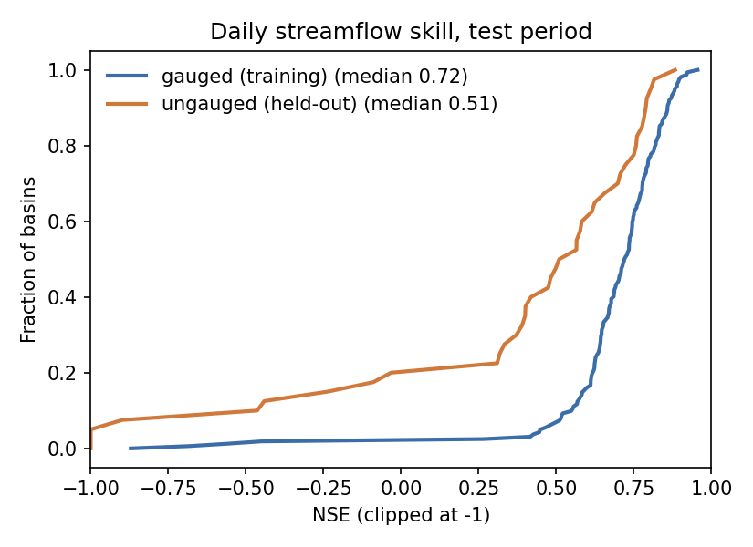
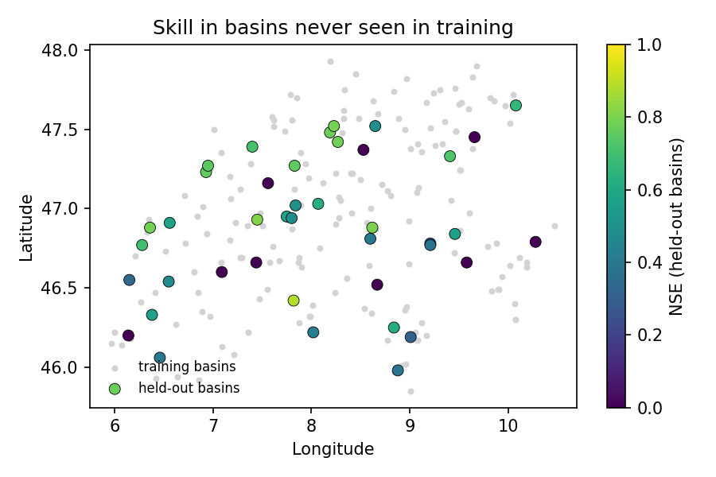
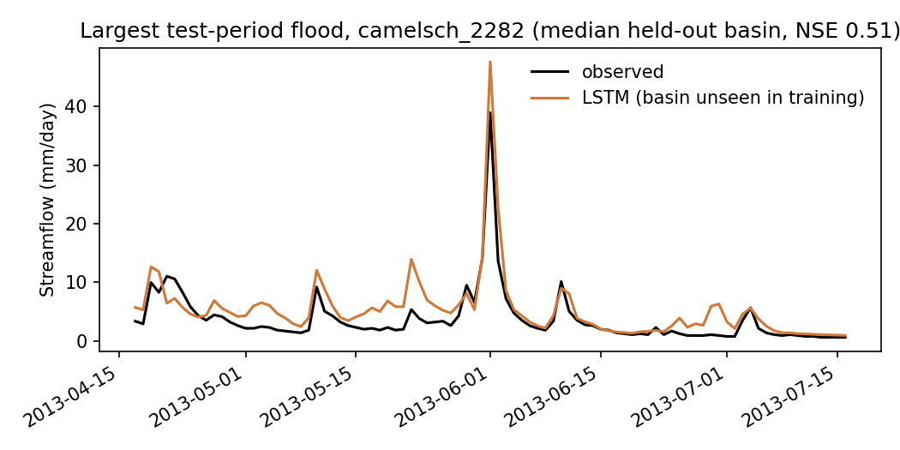
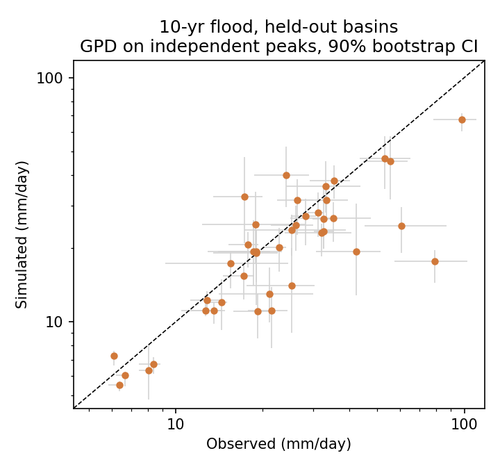

# alpine-flood-lstm

**Regional LSTM flood modelling for Swiss catchments: skill in ungauged basins, flood peaks and tail behaviour.**

One LSTM is trained on many Swiss catchments at once (CAMELS-CH in Caravan format, ERA5-Land forcing),
then tested on a 12-year period it never saw, in two settings:

- **Gauged:** catchments used in training, new time period.
- **Ungauged:** 20% of catchments held out entirely, standing in for basins with no gauge.

The gap between the two is the regionalisation gap: how much skill is lost when the model is transferred to
a catchment it has never seen.

Most large-sample studies stop at NSE/KGE. This project also asks whether the model gets **floods** right:

1. **Peak timing and magnitude:** peak-timing error, peak MAPE, high-flow volume bias (FHV), and annual-maximum ratio and timing.
2. **Tail behaviour:** a Generalised Pareto distribution is fitted to the ~3 largest independent events per year,
   separately for observed and simulated flow. The 10-year return levels are compared with 90% bootstrap
   confidence intervals. A model can score a high NSE and still underestimate the floods that matter.

## Results

Test period October 2008 to September 2020, never used in training. Of 296 CAMELS-CH catchments, 204 have at least 80%
streamflow coverage in both the training and test periods. These are split at random into 163 training catchments and
41 held-out ("ungauged") catchments.

Main model (`medium`: LSTM with 128 hidden units, 365-day input, trained on 1985-2005):

| Metric (median across catchments) | Gauged (163) | Ungauged (41) |
|---|---|---|
| NSE | 0.72 | 0.51 |
| KGE | 0.78 | 0.56 |
| High-flow volume bias, FHV (%) | -14.6 | -11.5 |
| Peak timing error (days) | 0.44 | 0.50 |
| Peak magnitude error, MAPE (%) | 38 | 42 |
| Annual maximum, simulated / observed | 0.67 | 0.70 |
| 10-year return level, simulated / observed (GPD) | 0.85 | 0.88 |
| 10-year return level: observed and simulated 90% CIs overlap | 75% | 71% |

Effect of model capacity and training length (`fast`: 64 hidden units, 270-day input, 1995-2005, short epochs; results in `results_fast/`):

| Median | fast, gauged | medium, gauged | fast, ungauged | medium, ungauged |
|---|---|---|---|---|
| NSE | 0.64 | 0.72 | 0.50 | 0.51 |
| KGE | 0.68 | 0.78 | 0.52 | 0.56 |
| Annual maximum, sim / obs | 0.59 | 0.67 | 0.62 | 0.70 |
| 10-year return level, sim / obs | 0.67 | 0.85 | 0.67 | 0.88 |

| | |
|---|---|
|  |  |
|  |  |

### Findings

1. **Transfer to unseen catchments works for most, not all.** On held-out catchments the median NSE is 0.51, against
   0.72 where the model was trained. About four in five held-out catchments keep useful skill, but roughly one in five
   falls below NSE 0, which points to catchments whose behaviour the static attributes do not capture (likely candidates:
   lake regulation, hydropower, karst or glaciers).
2. **A larger model helps where it has data, not where it doesn't.** Moving from `fast` to `medium` raises gauged NSE from
   0.64 to 0.72, but ungauged NSE barely moves (0.50 to 0.51). The regionalisation gap grows with capacity, so better
   transfer needs better catchment descriptors or more diverse training catchments, not just a bigger model.
3. **Flood timing is right; flood size is biased low.** Peaks arrive within about half a day, but annual maxima reach
   only about 70% of observed values. This is the known tendency of LSTMs trained with a mean-error loss to smooth
   extremes.
4. **The tail improves more than the daily peaks.** The 10-year return level ratio rises from 0.67 to about 0.87 with the
   larger model, and observed and simulated confidence intervals overlap in about 70% of held-out catchments. The
   largest floods (observed 10-year levels of 80-100 mm/day) are still clearly underestimated, so the model should not be
   trusted for the rarest events without a correction step.

## Design choices

| Choice | Why |
|---|---|
| Split by whole basins, plus a separate time period | Tests transfer in space and time together, which is the operational situation for a new site. A random time split would leak information. |
| One regional model, static catchment attributes as inputs | Lets the model learn how catchment properties (area, elevation, slope, snow fraction and others) shape the response, which is what makes transfer possible. |
| NSE loss, normalised per basin | Stops large, high-flow basins dominating training. |
| Validation on training basins only | Held-out basins stay completely unseen until the final test. |
| GPD on independent peaks (≥ 7 days apart), fixed event rate | Standard peaks-over-threshold approach. A fixed rate keeps the threshold comparable between observed and simulated series. |
| Fixed random seed, generated configs | The split and the variable selection can be reproduced. Variable names are matched to the data version, since Caravan renamed some PET fields in v1.5. |

## Run it

About an hour on a laptop GPU with the `medium` config, most of it unattended training.

```bash
# 1. Environment
python -m venv .venv && source .venv/bin/activate
pip install -r requirements.txt

# 2. Data: CAMELS-CH, Caravan extension (~550 MB) from Zenodo, record 15025258
mkdir -p data && cd data
curl -L -o Caravan_extension_CH.zip "https://zenodo.org/records/15025258/files/Caravan_extension_CH.zip?download=1"
unzip -q Caravan_extension_CH.zip && cd ..

# 3. Everything: split, train, evaluate, analyse
./run_all.sh medium mps        # Apple GPU; use cpu or cuda:0 elsewhere
# On Apple GPUs, prefix with PYTORCH_ENABLE_MPS_FALLBACK=1 if an MPS error appears
```

Outputs go to `results/`: `summary.md`, `basin_metrics.csv` (every metric per basin) and four figures.

| Config | Training years | Model | Epochs | Time on Apple M-series GPU |
|---|---|---|---|---|
| `fast` | 1995-2005 | LSTM, 64 hidden units, 270-day input | 12 × 400 updates | ~5 min |
| `medium` | 1985-2005 | LSTM, 128 hidden units, 365-day input | 25 × 1500 updates | ~1 h |
| `full` | 1985-2005 | LSTM, 256 hidden units, 365-day input | 30, full epochs | GPU recommended |

Smoke test without the real data (fake catchments from a simple snow and bucket model):

```bash
python tests/make_synthetic.py --out data/synthetic
DATA=data/synthetic ./run_all.sh fast cpu
```

## Limitations

- Daily resolution only. Small, fast Alpine catchments can peak within hours, so daily data smooths peak magnitude.
- ERA5-Land forcing (~9 km) under-resolves convective precipitation in complex terrain. Gridded station data (e.g. MeteoSwiss) should do better.
- A 12-year test period limits tail estimates to roughly the 10-year level. Longer return periods would be extrapolation.
- Some CAMELS-CH catchments are regulated (hydropower, lakes). They are kept in, which may lower skill for those basins.
- One random split and one training seed. An ensemble of seeds and a k-fold split over catchments would give uncertainty on the headline numbers.

## Next steps

- **Flood-aware training:** test losses that weight high flows more, or a GPD-based correction of simulated peaks, to reduce the low bias at extremes.

- **Forecast mode:** drive the trained model with weather forecasts (ECMWF IFS, AI models such as AIFS or GraphCast)
  instead of reanalysis, and measure skill against lead time. Caravan MultiMet provides IFS HRES and GraphCast forecasts in Caravan format.
- **Ensembles and uncertainty:** run ensemble forecasts through the model and check whether the predictive spread is calibrated for flood peaks.
- **Counterfactual storylines:** force the model with the same extreme event in pre-industrial, present and warmer climates
  (km-scale storyline simulations) and test how far an LSTM trained on data can be trusted outside the conditions it was trained on.
- **Sub-daily and fine-tuning:** hourly targets for small catchments, and fine-tuning the regional model on short local records.

## References

- Kratzert et al. (2023). Caravan: A global community dataset for large-sample hydrology. *Scientific Data* 10, 61.
- Höge et al. (2023). CAMELS-CH: hydro-meteorological time series and landscape attributes for 331 catchments in hydrologic Switzerland. *ESSD* 15, 5755-5784.
- Kratzert et al. (2019). Toward improved predictions in ungauged basins: Exploiting the power of machine learning. *Water Resources Research* 55.
- Kratzert et al. (2022). NeuralHydrology: A Python library for deep learning research in hydrology. *JOSS* 7(71), 4050.
- Shalev & Kratzert (2024). Caravan MultiMet: Extending Caravan with multiple weather nowcasts and forecasts. arXiv:2411.09459.
